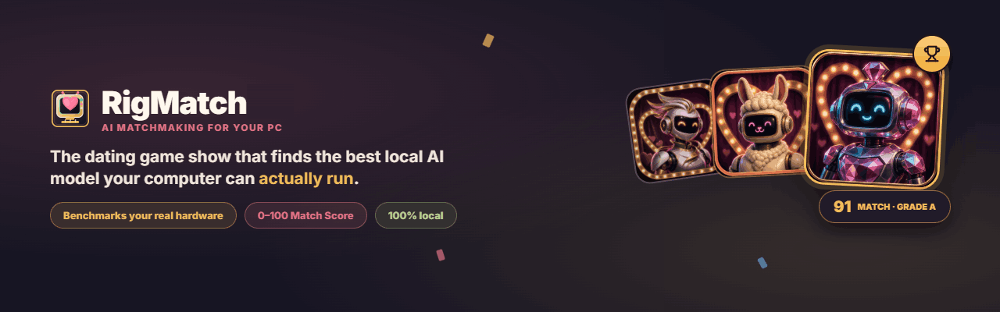
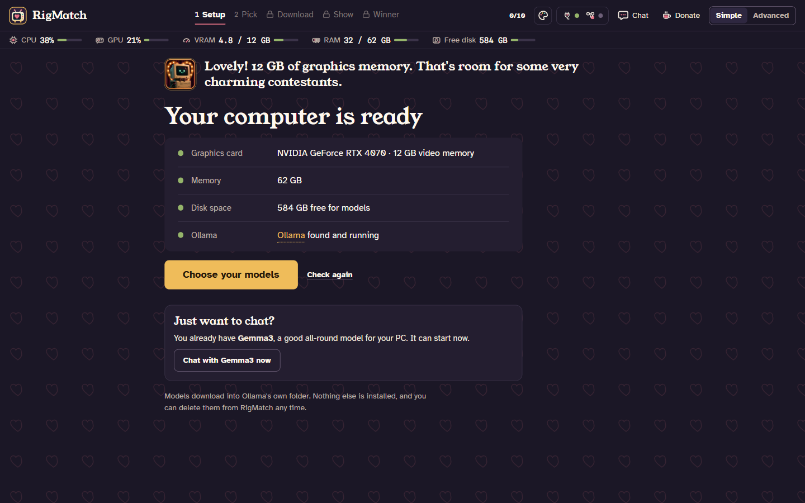
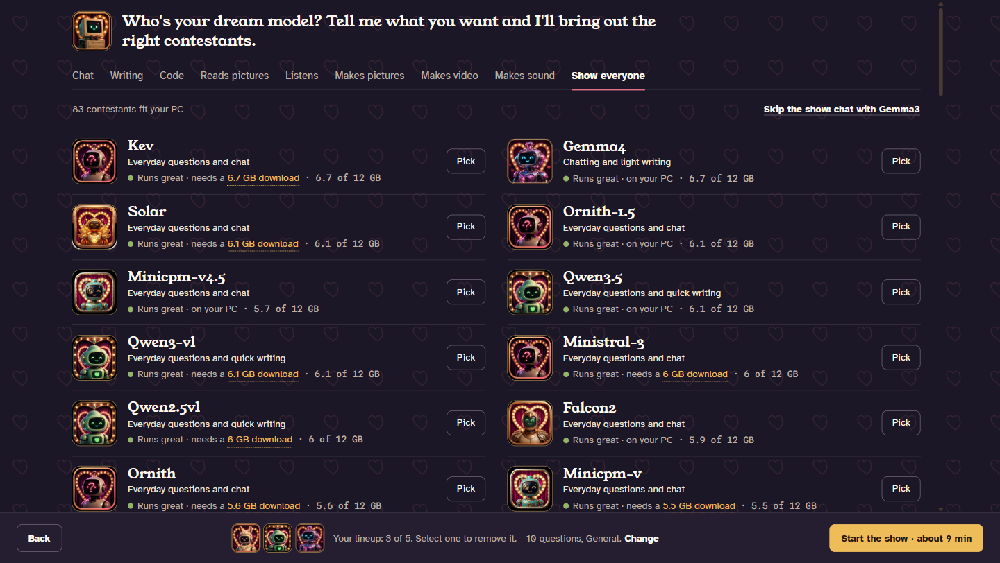
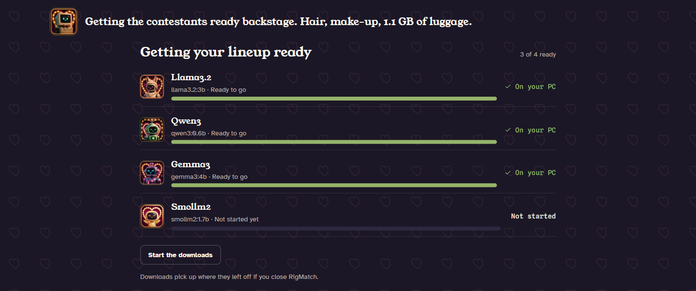
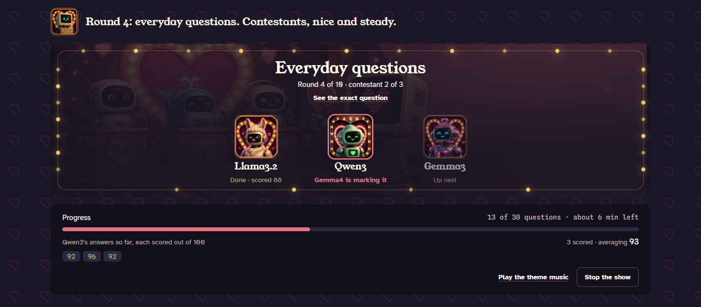
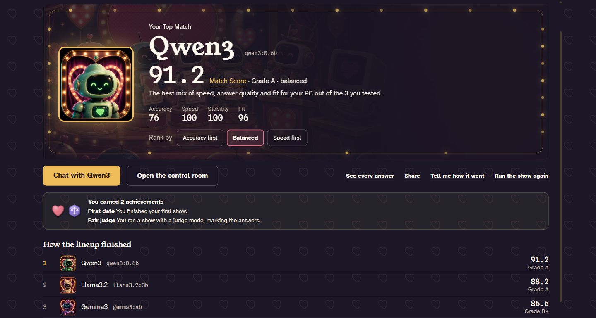
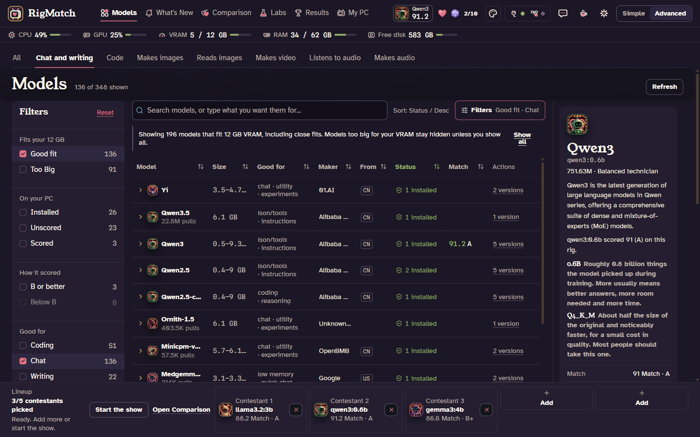

<p align="center">
  
</p>

<h1 align="center">RigMatch</h1>

<p align="center">
  <strong>Find the best local AI model your computer can <em>actually</em> run.</strong><br>
  A dating game show for your PC: models are contestants, benchmarks are speed dates, and the winner is your Top Match.
</p>

<p align="center">
  
  
  
  
  
  
</p>

---

## What is RigMatch?

Picking a local LLM is confusing: parameter counts, quantization, VRAM, context windows… RigMatch skips all of that. It **benchmarks models on your actual hardware** through [Ollama](https://ollama.com) or [LM Studio](https://lmstudio.ai), scores each one on **speed, answer quality, and hardware fit**, and crowns a **Top Match** with a 0–100 Match Score.

Everything runs on your machine. No account, no telemetry, and no cloud unless you turn on the OpenRouter judge (see [Privacy](#privacy)).

**RigMatch is donationware.** Every feature is free, and nothing is locked if you don't donate. If it helps you, you can [buy me a coffee](https://buymeacoffee.com/daveeuson).

- 🖥️ **Reads your real rig**. GPU, VRAM, RAM and disk decide which contestants even qualify
- 💛 **Speed Dating benchmarks**. Every model answers the same questions, live on stage
- 🏆 **Match Score (0–100)** — speed, quality and fit, scored on your PC
- 💬 **Chat with the winner** in RigMatch Chat, or skip the show and start chatting
- 🖼️ **Pictures, video and sound** through ComfyUI, if you have it
- 🎨 **5 color themes** and illustrated contestant avatars for every model family

## Simple Mode — local AI for everyone

A five-step guided wizard for people who have never heard of VRAM and just want "the best AI for my PC." A game-show host walks you through the whole thing.

### 1 · Setup — check your computer

RigMatch finds Ollama or LM Studio and reads your graphics card, memory and free disk space. No jargon, just "Your computer is ready."

<p align="center"></p>

**Just want to chat?** The card under **Choose your models** skips the show. It offers a good all-round model for your PC: if you already have it, the chat opens straight away; if not, it tells you how big the download is and asks before getting it. Pick has the same way out, a **Skip the show** link.

<!-- Screenshots 2–5 are cropped below the top bar: it repeats on every
     step, and a walkthrough that re-shows it makes the reader hunt for what
     changed (first outside review). -->

### 2 · Pick — meet the contestants

Choose what you want a model for (Chat, Writing, Code, Reads pictures, Listens, Makes pictures, Makes video, Makes sound) and pick up to five contestants that fit your PC. Each card says whether the model is already on your PC or how big its download is. One card per model; RigMatch picks the right size for your hardware. **Not sure? Choose for me** picks a lineup for you.

<p align="center"></p>

### 3 · Download — the contestants arrive

RigMatch asks before it downloads anything, then shows live progress while your lineup installs. Stop anytime; downloads resume if you close the app. If every model in your lineup is already on your PC, this step is skipped.

<p align="center"></p>

### 4 · Show — Speed Dating, live on stage

One sheet before the start says which questions run, who marks them and how hard your computer will work. Then every contestant answers the same questions on the game-show stage, one at a time, with live scores. Stop ends the whole show.

<p align="center"></p>

### 5 · Winner — your Top Match

The reveal: your Top Match under the lights with its grade, Match Score and the four measurements behind it. **Rank by** moves the crown between Accuracy first, Balanced and Speed first. Then two doors out (start chatting right away, or open the control room, which is Advanced Mode) and how the whole lineup finished.

<p align="center"></p>

## Chatting with your models

**RigMatch Chat** is the chat window that comes with RigMatch. Open it from **Chat** in the top bar, from the Winner screen, or from the Just want to chat? card. It lists your Ollama models with their Match Scores, and it remembers only what you ask it to keep, in a "What it remembers" panel you can read and add to. LM Studio models chat in a panel inside RigMatch instead, because RigMatch Chat lists only Ollama's models.

## Pictures, video and sound

**Makes pictures**, **Makes video** and **Makes sound** run in [ComfyUI](https://www.comfy.org/download), a separate free program that RigMatch doesn't install or bundle. RigMatch looks for it by itself on port 8188 (the portable and manual installs) and 8000 (ComfyUI Desktop); if yours runs somewhere else, set its address in Settings. Pick shows the makers that fit your graphics card, and Simple Mode can download picture makers such as Z-Image Turbo and FLUX.2 [klein], after telling you how much each one fetches. Without ComfyUI, Simple Mode explains how to get it.

## Advanced Mode

The full control room, with its tabs in the top bar. Your Top Match carries over.

- **Models**: every model RigMatch knows, each with a Fit grade for your PC (A to F, with the reasons a click away), filters for what it can do, plus downloads
- **What's New**: models that just appeared in Ollama's catalog
- **Comparison**: run a show with the models, questions and judge you choose, and add skill tests such as Build an app or the Code challenge
- **Labs**: picture, video and sound makers given the same prompt, and listening tests
- **Results**: your Top Match and its measurements, the ranking, and every test you've run, with a fader between accuracy and speed
- **My PC**: your hardware, Setup Doctor and logs
- **Settings** (the gear): one section at a time, picked from a list

<p align="center"></p>

## Getting started

1. **Install [Ollama](https://ollama.com/download)** and make sure it's running. Already use [LM Studio](https://lmstudio.ai)? RigMatch tests the models you have there too, while LM Studio's local server is running. Downloads go through Ollama.
2. **Download RigMatch** for your platform:

| Platform | Installer |
|---|---|
| Windows | `.exe` installer or `.zip` portable · [Releases](../../releases/latest) |
| macOS (Apple Silicon) | `.dmg` for M-series Macs · [Releases](../../releases/latest) |
| macOS (Intel) | `.dmg` for Intel Macs · [Releases](../../releases/latest) |
| Linux x64 | `.AppImage` or `.deb` for x64 Debian/Ubuntu · [Releases](../../releases/latest) |
| Linux ARM64 / Jetson | `.AppImage` or `.deb` for ARM64/aarch64 · [Releases](../../releases/latest) |

3. Launch it — Simple Mode will check your computer and take it from there

<details>
<summary><strong>Windows first-launch note</strong> (unsigned builds)</summary>

RigMatch's Windows builds are not code-signed, because a signing certificate costs money every year and RigMatch is free. So the first time you run the installer (or `RigMatch.exe` from the `.zip`), Windows SmartScreen may say **"Windows protected your PC"**.

1. Click **More info**. It shows the file name and **Publisher: Unknown publisher**.
2. Click **Run anyway**.

To check that your download is the one GitHub built, compare its SHA-256 with the line for that file in **SHA256SUMS.txt** on the same release page (upper or lower case doesn't matter):

```powershell
Get-FileHash .\RigMatch-*-win-x64.exe -Algorithm SHA256
```

Or, with the [GitHub CLI](https://cli.github.com), check the build attestation:

```bash
gh attestation verify RigMatch-<version>-win-x64.exe --repo DaveEuson/RigMatch
```
</details>

<details>
<summary><strong>macOS first-launch note</strong> (unsigned beta builds)</summary>

RigMatch macOS downloads are unsigned beta builds distributed outside the App Store. On first launch, macOS may say the developer cannot be verified.

1. Download the correct `.dmg`: **mac-arm64** for Apple Silicon, **mac-x64** for Intel.
2. Open the `.dmg` and drag **RigMatch** to **Applications**.
3. First launch only: right-click **RigMatch.app**, choose **Open**, then **Open** again.
4. If macOS still blocks it, open **System Settings → Privacy & Security → Security** and choose **Open Anyway**.

If macOS says the app is **"damaged and can't be opened"**, and nothing appears
in Privacy & Security to let you open it anyway, run this once:

```bash
xattr -dr com.apple.quarantine "/Applications/RigMatch.app" && codesign --force --deep --sign - "/Applications/RigMatch.app"
```

Both halves matter on Apple Silicon. Clearing the quarantine flag alone is not
enough: an arm64 app will not launch unless its code signature validates, and
that is the part that was broken. The second command re-signs it locally.

This affects builds up to and including 0.4.2. Later releases sign themselves
during the build, so "damaged" should not appear at all. You may still see the
ordinary unidentified-developer prompt covered in the steps above.
</details>

<details>
<summary><strong>Linux &amp; Jetson note</strong></summary>

Pick the file for your processor: **amd64 / x86_64** for most PCs, **arm64** for NVIDIA Jetson and other ARM64 boards.

**`.deb` (Debian, Ubuntu, JetPack):** install it through `apt`, which also installs everything RigMatch Chat needs:

```bash
sudo apt update
sudo apt install ./RigMatch-*-linux-amd64.deb
```

On a Jetson or another ARM64 board, the file ends in `linux-arm64.deb` instead.

Double-clicking the `.deb` can open your software store instead. On Pop!_OS 24.04 the COSMIC Store shows an Install button that does nothing, so use the command above.

**AppImage:** make it executable, then open it:

```bash
chmod +x RigMatch-*.AppImage
./RigMatch-*.AppImage
```

An AppImage installs nothing, so RigMatch Chat uses your system's WebKitGTK 4.1. If it is missing, RigMatch says so when you open Chat; on Debian and Ubuntu:

```bash
sudo apt install libwebkit2gtk-4.1-0
```

AppImages up to 0.9.1 also need libfuse2 to open, which Ubuntu 22.04 and newer do not install: `sudo apt install libfuse2` on 22.04, `libfuse2t64` on 24.04. Later AppImages do not need it.
</details>

### Build from source

```bash
git clone https://github.com/DaveEuson/RigMatch.git
cd RigMatch
npm install
npm run dev        # development
npm run build      # production build
```

## Command-line fit check

The Fit grade from the Models list, in a terminal: which models will run well on this computer, best first, with the command that gets each one. It reads your graphics card the way the app does and asks a local Ollama, if one is running, which models you already have. Nothing is downloaded and nothing leaves your computer.

```bash
npm install
npm run build:cli
node cli/dist/rigmatch-fit.mjs
```

```text
Grade  Model          Size    Speed      Fit         Get it
A      qwen3.5:9b     6.6 GB  ~46 tok/s  Sweet spot  ollama pull qwen3.5:9b
A      gemma2:9b      5.4 GB  ~56 tok/s  Sweet spot  ollama pull gemma2:9b
```

| Option | Does |
|---|---|
| `--all` | List every model, including the ones that will not fit |
| `--installed` | List only the models Ollama already has, graded |
| `--json` | Print every model as JSON, for scripts (with `--installed`, only those) |
| `--provider lmstudio` | Print LM Studio's `lms get` commands instead of `ollama pull` |
| `--vram 16` | Grade for a card with 16 GB instead of this one |

A is the best pick for this computer and F will not fit. The grade weighs answer quality (by size and model family), estimated speed, and the room left in graphics memory. It is a different scale from the Match Score, which RigMatch measures by actually running the model. The bundled file runs on Node 20 or later on Windows, macOS and Linux; its only dependency is [systeminformation](https://www.npmjs.com/package/systeminformation).

## How the Match Score works

Each model runs the same question set on your hardware. The score blends:

| Ingredient | What it measures |
|---|---|
| ⚡ Speed | Tokens/sec and first-token latency on your rig |
| 🎯 Quality | Whether answers hold up: valid JSON, followed instructions, no invented facts. Fixed rules mark most answers. A judge model marks the open-ended ones: one of your local models, picked for you unless you choose, or an OpenRouter model if you turn that on. A quick check uses rules only |
| 🧩 Fit | How comfortably the model sits in your VRAM/RAM |

The result is a 0–100 Match Score and a letter grade, measured on your machine rather than a leaderboard's H100. Speed and fit are measured directly. Quality is the softest of the three, which is why the app shows the breakdown rather than only the total.

## Privacy

Models run on your hardware through Ollama or LM Studio. RigMatch has no account and no telemetry, and nothing you type, test or score leaves your computer unless you switch one of these on:

- **The OpenRouter judge.** If you choose it and add your own OpenRouter key, the questions it marks and your models' answers to them go to OpenRouter, and so do the apps and code it reviews in Labs.
- **A cloud model.** Ollama's cloud models run on Ollama's servers, so a test of one sends its questions there.

The sheet before every test says what leaves your computer, if anything.

## License

Source-available, not open source — see [LICENSE](LICENSE).

The code is published so you can read it and check what the app does, which is
the point of a privacy claim you can't otherwise verify. It does not grant
rights to copy, modify, or redistribute it. Using the released app is fine.

---

<p align="center"><sub>Made with 💛 and a retro-computer host.</sub></p>
